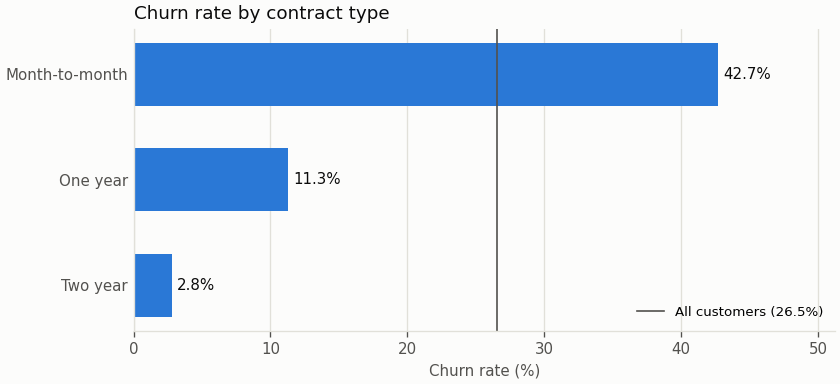
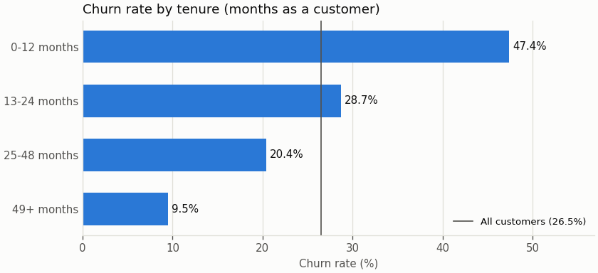
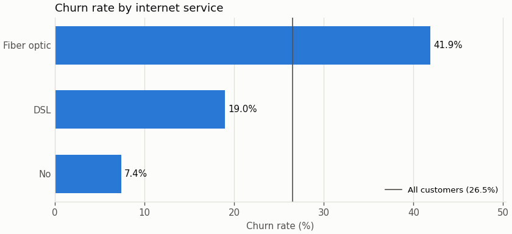
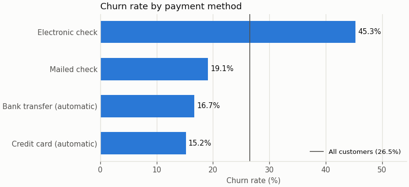
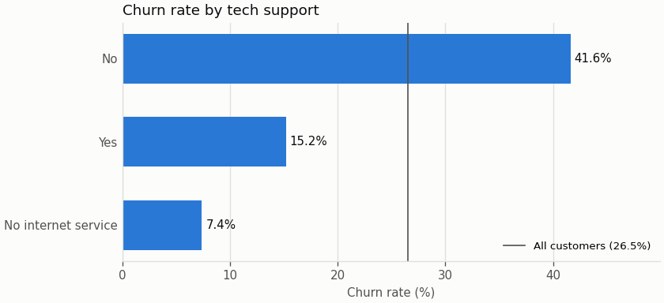
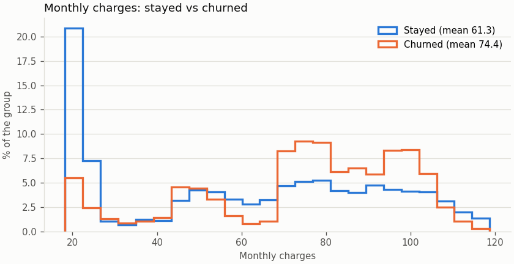
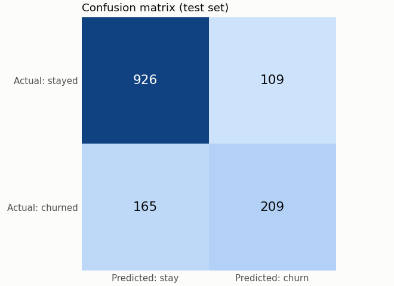

# Telco Customer Churn Prediction & Data Quality Pipeline

A small, reproducible Python machine-learning application built for the UST *Python AI/ML Beginner
Capstone*. It loads the IBM Telco customer CSV, validates and cleans it, explores churn patterns,
trains a classifier, evaluates it, writes a customer-risk predictions file, and runs its test suite
automatically with GitHub Actions.

## Business problem

A (fictional) telecom company wants to spot customers who are likely to leave the service (*churn*),
so that a retention team can contact them first.

**Question:** can customer information - tenure, contract type, services, payment method, monthly
charges and the other attributes - be used to predict whether a customer will churn?

> **Important limitation.** The IBM file is a cross-sectional sample used for teaching. This project
> reports patterns and model performance; it does **not** show that any attribute *causes* churn, or
> that a retention action would prevent it.

## Dataset

| Item | Value |
|---|---|
| Source | IBM sample data - [`IBM/telco-customer-churn-on-icp4d`](https://github.com/IBM/telco-customer-churn-on-icp4d), file [`data/Telco-Customer-Churn.csv`](https://github.com/IBM/telco-customer-churn-on-icp4d/blob/master/data/Telco-Customer-Churn.csv) |
| Attribution | Published by IBM in a repository licensed under Apache-2.0. Educational sample - not real customers. |
| Size | 7,043 customers x 21 raw columns |
| Target | `Churn` (Yes / No) - binary classification |
| Identifier | `customerID` - kept for the output, never used as a feature |
| Location in this repo | `data/raw/Telco-Customer-Churn.csv` |

If the CSV is missing, `python main.py --download` fetches it from the IBM repository. An existing
file (for example an instructor-provided copy) is never overwritten, and the program never edits it.

Column groups: demographics (`gender`, `SeniorCitizen`, `Partner`, `Dependents`); services
(`PhoneService`, `MultipleLines`, `InternetService`, `OnlineSecurity`, `OnlineBackup`,
`DeviceProtection`, `TechSupport`, `StreamingTV`, `StreamingMovies`); account (`tenure`, `Contract`,
`PaperlessBilling`, `PaymentMethod`); billing (`MonthlyCharges`, `TotalCharges`).

## Project architecture

```
telco-churn-capstone/
├── data/
│   ├── raw/Telco-Customer-Churn.csv      # original file - only ever read
│   └── processed/telco_churn_clean.csv   # written by the pipeline (git-ignored)
├── src/
│   ├── config.py          # paths, column groups, validation rules, model settings
│   ├── data_loader.py     # load the CSV (+ optional download), basic input checks
│   ├── validator.py       # data-quality checks and the validation report
│   ├── preprocessing.py   # cleaning, X/y split, train/test split, encoders
│   ├── analysis.py        # churn-rate tables and EDA findings
│   ├── charts.py          # Matplotlib charts (EDA + confusion matrix)
│   ├── model.py           # Logistic Regression / Decision Tree pipelines
│   ├── evaluation.py      # metrics, confusion matrix, predictions table, output files
│   └── pipeline.py        # runs every stage in order
├── tests/                 # pytest suite - uses synthetic data, no CSV needed
├── output/                # validation_report.txt, metrics.json, predictions.csv, figures/
├── .github/workflows/ci.yml
├── telco_churn_capstone.ipynb   # guided build + demo notebook
├── main.py                # command-line entry point
├── requirements.txt
└── pytest.ini
```

Flow: `CSV -> load -> validate -> clean -> explore -> split -> train -> predict -> evaluate -> predictions.csv + metrics -> pytest -> GitHub Actions`

## Installation

```bash
git clone https://github.com/<your-username>/telco-churn-capstone.git
cd telco-churn-capstone
python -m venv .venv
source .venv/bin/activate          # Windows: .venv\Scripts\activate
pip install -r requirements.txt
```

Python 3.9 or newer works; the CI workflow uses Python 3.11.

## How to run the application

```bash
python main.py --input data/raw/Telco-Customer-Churn.csv
```

| Option | Meaning |
|---|---|
| `--input PATH` | raw CSV to process (default `data/raw/Telco-Customer-Churn.csv`) |
| `--output-dir DIR` | where the report, metrics, predictions and charts go (default `output/`) |
| `--download` | download the IBM CSV to `--input` first if that file is missing |
| `--no-charts` | skip the PNG charts |

Files written: `output/validation_report.txt`, `output/metrics.json`, `output/predictions.csv`,
`output/figures/*.png` and `data/processed/telco_churn_clean.csv`.

To walk through the project step by step, open `telco_churn_capstone.ipynb`
(`pip install notebook` then `jupyter notebook`, or open it in VS Code).

## How to run the tests

```bash
pytest
```

`pytest.ini` points pytest at `tests/` and puts the project root on the import path, so the same
command works locally and in CI. The tests build a 60-row synthetic sample in the raw IBM format, so
they do not need the real CSV.

| Test file | What it protects |
|---|---|
| `test_data_loader.py` | the CSV loads with every row and column; a missing file gives a clear error; the real file (when present) matches the data dictionary |
| `test_validator.py` | required columns, Churn labels before encoding, duplicate IDs, blank TotalCharges, negative / out-of-range values, unexpected categories, PASS on clean input |
| `test_preprocessing.py` | TotalCharges numeric after cleaning, no negative charges, Churn encoded 1/0, raw data never modified, duplicates and bad labels removed, customerID not a feature, reproducible stratified split |
| `test_model.py` | both models train on a small sample and predict only 0/1 with probabilities in [0, 1]; unknown model names are rejected; the predictions table has the required columns; metrics match a hand calculation |
| `test_pipeline.py` | the whole pipeline runs end to end and leaves the raw CSV byte-for-byte unchanged; EDA charts are written |

## Validation checks performed

`src/validator.py` answers each question from the brief and prints a plain-English report
(saved as `output/validation_report.txt`):

| Question | Check |
|---|---|
| How many rows and columns? | counts |
| Are the required columns present? | compare with the 21 columns of the data dictionary |
| What data type does each column have? | dtype summary + numeric columns stored as text |
| Are customer IDs duplicated? | repeated `customerID` values |
| Which columns contain missing values? | real NaN **plus blank / whitespace-only text** (pandas reads `" "` as text, not as NaN) |
| Does TotalCharges behave like a number? | values that fail numeric conversion, with the tenure of those customers |
| Is tenure in a reasonable range? | 0-120 months (a generous sanity bound) |
| Are MonthlyCharges and TotalCharges non-negative? | count of values below 0 |
| Does Churn contain only Yes/No? | invalid target labels |
| Are there unexpected categories? | every categorical value vs the data dictionary (and SeniorCitizen in {0, 1}) |
| Business rule | no internet -> all six add-ons say "No internet service"; no phone -> MultipleLines says "No phone service" (checked both ways) |

The overall status is **PASS** when nothing needs fixing, otherwise **REVIEW** with a list of items.
After cleaning, `check_clean_data()` re-checks the cleaned table (no missing values, numeric types,
no negatives, Churn in {0, 1}, unique IDs) and the pipeline stops if any check fails.

## Cleaning decisions

| # | What changed | Why |
|---|---|---|
| 1 | The program works on a copy; the raw CSV is only read | reproducibility - the original data stays untouched (a test compares the file's hash before and after a run) |
| 2 | `TotalCharges` text -> float (strip spaces, `pd.to_numeric(errors="coerce")`) | it is numeric data that pandas read as text because of 11 blank cells |
| 3 | The 11 blank `TotalCharges` -> `MonthlyCharges x tenure` | all 11 customers have `tenure = 0` (they just joined and have not been billed), so the formula gives 0.0 - a factual value rather than a guess. Every customer keeps a prediction; dropping 11 of 7,043 rows would also have been acceptable |
| 4 | `Churn`: Yes -> 1, No -> 0 | scikit-learn needs a numeric target; 1 marks the event we want to find |
| 5 | Repeated `customerID` -> keep the first row; `Churn` other than Yes/No -> drop the row (0 of each in the IBM file) | one row per customer, and a row without a known outcome cannot be used for training or evaluation |
| 6 | `customerID` kept in the cleaned table but excluded from `X` | it identifies a customer but carries no meaning for prediction; it is needed to label the predictions |
| 7 | Encoding inside the model pipeline: `StandardScaler` for tenure / MonthlyCharges / TotalCharges, `SeniorCitizen` passed through (already 0/1), `OneHotEncoder(handle_unknown="ignore")` for the 15 text columns | fitted on the training split only and reused unchanged on the test split and new data - consistent encoding, no leakage, and an unseen category does not crash a prediction |

## Features used by the model

19 columns = the 21 raw columns minus `customerID` and `Churn`:

* numeric, scaled: `tenure`, `MonthlyCharges`, `TotalCharges`
* binary, used as is: `SeniorCitizen`
* categorical, one-hot encoded: `gender`, `Partner`, `Dependents`, `PhoneService`, `MultipleLines`,
  `InternetService`, `OnlineSecurity`, `OnlineBackup`, `DeviceProtection`, `TechSupport`,
  `StreamingTV`, `StreamingMovies`, `Contract`, `PaperlessBilling`, `PaymentMethod`

## Model

* **Train/test split:** 80 % / 20 %, `random_state=42`, stratified on `Churn` so both sets keep the
  same churn share.
* **Primary model - Logistic Regression** (`max_iter=1000`): the recommended beginner classifier.
  It is fast and stable, outputs a churn probability (used as the risk score) and has coefficients
  that can be read and explained.
* **Comparison model - Decision Tree** (`max_depth=5`, `min_samples_leaf=20`): depth is limited so the
  tree cannot memorise the training customers (see the overfitting check in the results).
* All settings live in `src/config.py`.

## Results

<!-- RESULTS:START -->
_Filled in by the notebook on 2026-10-15 (Python 3.10.21, pandas 2.3.3,
scikit-learn 1.7.2). The validation report, metrics and predictions are read from the files
written by `python main.py`._

### Validation report (raw data)

```text
DATA VALIDATION REPORT
----------------------
Rows: 7043
Columns: 21
Required columns missing: none
Column types: object (18), int64 (2), float64 (1)
Numeric columns stored as text: TotalCharges
Duplicate customer IDs: 0
Missing-value fields: TotalCharges (11)
Target labels (Churn): No (5174), Yes (1869)
Invalid target values: none
TotalCharges conversion issues: 11 blank/non-numeric value(s); tenure of those customers: 0
Negative numeric values: none
Tenure outside 0-120 months: 0
Unexpected categorical values: none
Service consistency issues: 0
Overall status: REVIEW
To handle before modelling:
  - Missing or blank values in: TotalCharges (11)
  - TotalCharges has 11 value(s) that are not numbers
```

Cleaning then handled the only issue:

- TotalCharges converted from text to float; 11 blank value(s) filled with MonthlyCharges x tenure (tenure of those customers: [0])
- Duplicate customer IDs removed (first row kept): 0
- Rows removed because Churn was not Yes/No: 0
- Churn encoded as 1 = Yes (churned), 0 = No (stayed)

Cleaned-data checks: **PASS** (7,043 rows: no missing values, numeric types, no negative charges, Churn encoded 0/1).

### EDA findings

1. **About one customer in four churned (26.5%).** The classes are imbalanced: a model that always answers "stays" would already be right about 73% of the time, so accuracy alone says little.
2. **Contract type shows the biggest gap.** Month-to-month customers churned at 42.7%, one-year at 11.3% and two-year at 2.8%. Customers who already intend to stay may simply be the ones who sign long contracts.
3. **Churn is concentrated in the first year.** 47.4% of customers with 0-12 months of tenure churned, vs 9.5% after four years. Tenure and contract overlap: 91% of first-year customers are on month-to-month contracts.
4. **Fiber-optic customers churned more** (41.9%) than DSL customers (19.0%); customers without internet churned least (7.4%). Fiber customers also have higher bills (average 92 vs 58 for DSL), so price and service type are tangled.
5. **Payment method:** electronic-check payers churned at 45.3%, about 2.8x the rate of customers paying automatically by bank transfer or credit card.
6. **Higher bills go with churn:** churned customers paid 74.44 per month on average vs 61.27 for customers who stayed.
7. **Tech support:** customers without it churned at 41.6% vs 15.2% with it - a visible relationship, but not proof that adding support would keep a customer.

| | |
|---|---|
|  |  |
|  |  |
|  |  |

### Evaluation metrics

Test set: 1,409 customers (20% stratified split, `random_state=42`). The model sees 45 inputs after scaling and one-hot encoding.

| Metric | Logistic Regression | Decision Tree |
| --- | --- | --- |
| Accuracy | 0.806 | 0.798 |
| Precision | 0.657 | 0.635 |
| Recall | 0.559 | 0.567 |
| F1 Score | 0.604 | 0.599 |

**What the numbers mean (Logistic Regression):**

- Accuracy 80.6%: 1,135 of the 1,409 test customers are labelled correctly.
- Precision 65.7%: of the 318 customers flagged as likely to churn, 209 really churned.
- Recall 55.9%: of the 374 customers who really churned, the model caught 209.
- False negatives: 165 customers churned although the model said they would stay - a retention team would never have contacted them.
- False positives: 109 customers who stayed were flagged - the cost is an unneeded retention offer.
- Baseline: always predicting "stays" would reach accuracy 0.735 but recall 0 - accuracy alone is misleading on imbalanced data.

**Confusion matrix (Logistic Regression, test set):**

|  | Predicted: stay | Predicted: churn |
| --- | --- | --- |
| Actual: stayed | 926 | 109 |
| Actual: churned | 165 | 209 |



**Overfitting check (accuracy on training vs test customers):**

| Model | train accuracy | test accuracy | gap |
| --- | --- | --- | --- |
| logistic_regression | 0.806 | 0.806 | 0.0 |
| decision_tree (depth 5) | 0.803 | 0.798 | 0.004 |
| decision_tree (no depth limit) | 0.998 | 0.726 | 0.272 |

**Model choice:** The two models are close (F1 0.604 vs 0.599, recall 0.559 vs 0.567, precision 0.657 vs 0.635); Logistic Regression has the higher F1. Logistic Regression stays the primary model because it gives every customer a smooth risk score (1,407 distinct scores vs 30 for the depth-5 tree), has a small train/test gap and has weights that can be explained. A tree would be the better pick if the business wanted simple if/then rules.

### Example output

`output/predictions.csv` (1,409 test customers, highest risk first):

| customerID | actual_churn | predicted_churn | churn_probability | risk_level |
| --- | --- | --- | --- | --- |
| 5178-LMXOP | 1 | 1 | 0.8549 | High |
| 0295-PPHDO | 1 | 1 | 0.8321 | High |
| 6861-XWTWQ | 1 | 1 | 0.8286 | High |
| 8884-ADFVN | 1 | 1 | 0.8218 | High |
| 1069-XAIEM | 1 | 1 | 0.8188 | High |

Risk bands vs what really happened:

| risk_level | customers | actual_churn_% |
| --- | --- | --- |
| Low | 866 | 10.6 |
| Medium | 334 | 39.5 |
| High | 209 | 71.8 |

<details><summary>Console output of <code>python main.py</code></summary>

```text
============================================
TELCO CUSTOMER CHURN ANALYSIS
============================================

[1] Loading data...
Rows loaded: 7043 | Columns: 21 | File: data/raw/Telco-Customer-Churn.csv

[2] Validating data...
DATA VALIDATION REPORT
----------------------
Rows: 7043
Columns: 21
Required columns missing: none
Column types: object (18), int64 (2), float64 (1)
Numeric columns stored as text: TotalCharges
Duplicate customer IDs: 0
Missing-value fields: TotalCharges (11)
Target labels (Churn): No (5174), Yes (1869)
Invalid target values: none
TotalCharges conversion issues: 11 blank/non-numeric value(s); tenure of those customers: 0
Negative numeric values: none
Tenure outside 0-120 months: 0
Unexpected categorical values: none
Service consistency issues: 0
Overall status: REVIEW
To handle before modelling:
  - Missing or blank values in: TotalCharges (11)
  - TotalCharges has 11 value(s) that are not numbers
Saved: output/validation_report.txt

[3] Cleaning data...
- TotalCharges converted from text to float; 11 blank value(s) filled with MonthlyCharges x tenure (tenure of those customers: [0])
- Duplicate customer IDs removed (first row kept): 0
- Rows removed because Churn was not Yes/No: 0
- Churn encoded as 1 = Yes (churned), 0 = No (stayed)
Cleaned data checks: PASS (7043 rows) | Saved: data/processed/telco_churn_clean.csv

[4] Exploring data...
- 26.5% of customers churned (1,869 of 7,043), so the two classes are imbalanced.
- Churn rate by Contract: Month-to-month 42.7%, One year 11.3%, Two year 2.8%.
- Churn rate by InternetService: Fiber optic 41.9%, DSL 19.0%, No 7.4%.
- Churn rate by PaymentMethod: Electronic check 45.3%, Mailed check 19.1%, Bank transfer (automatic) 16.7%, Credit card (automatic) 15.2%.
- Churn rate by TechSupport: No 41.6%, Yes 15.2%, No internet service 7.4%.
- Churn rate by tenure_band: 0-12 months 47.4%, 13-24 months 28.7%, 25-48 months 20.4%, 49+ months 9.5%.
- Customers who churned had higher average MonthlyCharges (74.44 vs 61.27 for customers who stayed).
Saved 6 charts to: output/figures

[5] Training models...
Features: 19 columns (customerID and Churn are not features)
Train rows: 5634 | Test rows: 1409 (test_size=0.2, random_state=42, stratified)
Models trained: logistic_regression, decision_tree

[6] Evaluating models...
Primary model: logistic_regression
Accuracy : 0.806
Precision: 0.657
Recall   : 0.559
F1 Score : 0.604
Confusion matrix (test set):
                 Predicted: stay  Predicted: churn
Actual: stayed               926               109
Actual: churned              165               209
Model comparison (test set):
                     accuracy  precision  recall     f1
logistic_regression     0.806      0.657   0.559  0.604
decision_tree           0.798      0.635   0.567  0.599

[7] Writing predictions...
Saved: output/predictions.csv
Saved: output/metrics.json

Pipeline completed successfully.
```

</details>
<!-- RESULTS:END -->

## Limitations

* Cross-sectional educational sample: the findings are associations, not causes, and there is no
  time dimension (we do not know *when* a customer left).
* One fixed train/test split; metrics would move a little with another split.
* The 0.5 decision threshold is not tuned to the real cost of a missed churner vs an unneeded offer.
* The classes are imbalanced (roughly 1 churner for every 3 customers who stay), so accuracy alone
  flatters the model - precision and recall matter more.
* Some features overlap (TotalCharges is roughly MonthlyCharges x tenure), so single coefficients
  should not be over-interpreted.
* The pipeline retrains on every run; there is no saved model yet for scoring new, unlabelled customers.

## Future improvements

* Tune the decision threshold (or use `class_weight="balanced"`) to raise recall if missed churners are costly.
* 5-fold cross-validation and a small hyper-parameter search.
* Save the trained pipeline with `joblib` and add a prediction mode for new CSV files without a `Churn` column.
* Add a linting step to CI and a small Streamlit page that accepts a CSV and shows the predictions.
* Check probability calibration and evaluate with the retention team's real costs.

## Git workflow

```bash
git checkout -b feature/validation           # one branch per focused change
git add src/validator.py tests/test_validator.py
git commit -m "feat: add customer validation checks"
git push -u origin feature/validation         # open a pull request; CI runs pytest
```

Example commit messages: `feat: add CSV data loader`, `feat: add churn preprocessing pipeline`,
`feat: train logistic regression model`, `test: add validation unit tests`,
`ci: add GitHub Actions test workflow`, `docs: document project setup and results`.
